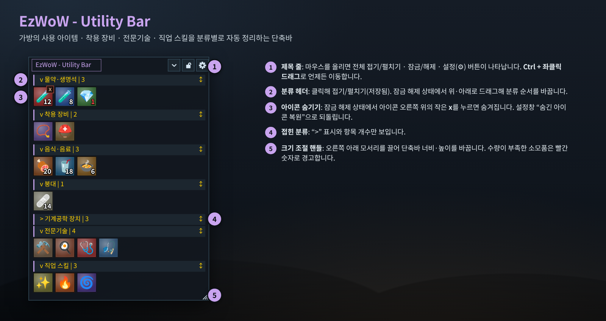
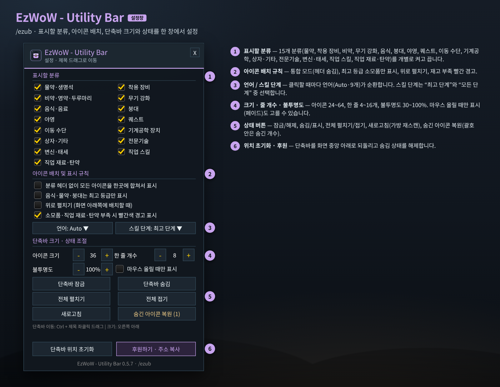
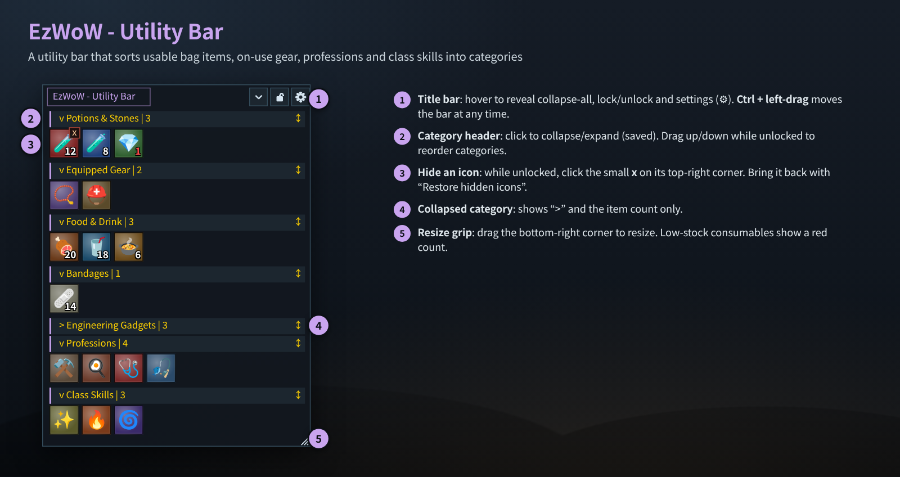
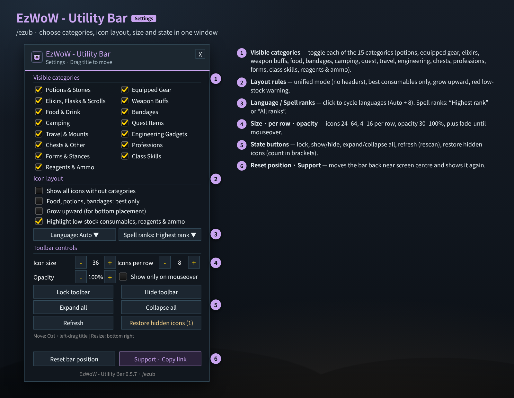

# EzWoW - Utility Bar (`EzWoW-UtilityBar`)

## CurseForge

- **Project ID / 프로젝트 ID:** `1741884`
- **Project page / 프로젝트 페이지:** [EzWoW-UtilityBar](https://www.curseforge.com/wow/addons/easyutilitybar)

**[한국어](#한국어) · [English](#english)**

WoW Forever (`Interface: 16001`) · `v0.5.7` · `/ezub`

---

## 한국어

### 개요

가방 속 사용 아이템, 착용 중인 사용 효과 장비, 전문기술, 변신·태세, 직업 보조 스킬을 **분류별로 자동 정리해서 작은 단축바 하나에 모아 주는** 애드온입니다. 새 물약을 줍거나 스킬을 배우면 바로 단축바에 추가되고, 다 쓰면 사라집니다. 전투 중에도 보안 액션 버튼으로 동작하므로 그대로 클릭해서 쓸 수 있습니다.

### 화면 미리보기

> 이미지는 애드온 코드에 들어 있는 창 크기·좌표·색상·문구를 그대로 옮겨 만든 **예시 화면**입니다. 아이콘과 아이템은 예시이며 실제 게임 화면과 조금 다를 수 있습니다.

### 설치

1. `EzWoW-UtilityBar` 폴더를 게임의 `Interface/AddOns/` 폴더에 폴더째 넣습니다.
2. 캐릭터 선택 화면의 **애드온** 목록에서 `EzWoW - Utility Bar`를 켭니다.
3. 접속하면 화면 가운데 아래쪽에 단축바가 나타납니다. 설정은 `/ezub`로 엽니다.

### 단축바 사용법 (위 그림의 번호)

| 번호 | 부분 | 설명 |
|---|---|---|
| ① | 제목 줄 | 마우스를 올리면 **전체 접기/펼치기 · 잠금/해제 · 설정(⚙)** 버튼이 나타납니다. **Ctrl + 좌클릭 드래그**로 단축바를 옮깁니다(잠금 상태에서도 됩니다). |
| ② | 분류 헤더 | `v 분류 이름 | 개수` 형태입니다. 클릭하면 그 분류를 접고 펼치며, 상태는 저장됩니다. 잠금을 풀면 헤더를 위·아래로 끌어서 **분류 순서**를 바꿀 수 있습니다. |
| ③ | 아이콘 숨기기 | 잠금 해제 상태에서 제목에 마우스를 올리면 아이콘 오른쪽 위에 작은 **x**가 생깁니다. 누르면 그 아이콘만 숨겨집니다. 설정창의 **숨긴 아이콘 복원**으로 되돌립니다. |
| ④ | 접힌 분류 | `>` 표시와 개수만 보입니다. 다시 누르면 펼쳐집니다. |
| ⑤ | 크기 조절 · 재고 경고 | 오른쪽 아래 모서리를 끌어 너비·높이를 직접 바꿉니다. 수량이 얼마 남지 않은 소모품·직업 재료·탄약은 숫자가 **빨간색**으로 바뀝니다. |

#### 자동 분류 (15개)

| 분류 | 들어가는 것 |
|---|---|
| 물약·생명석 | 생명력·마나 물약, 생명석 |
| 착용 장비 | 장신구, 기계공학 모자/장화/장갑 등 **착용 중인** 사용 효과 장비 |
| 비약·영약·두루마리 | 비약, 영약, 능력치 두루마리 |
| 무기 강화 | 숫돌, 무기 오일 등 |
| 음식·음료 | 일반 음식, 음료, 버프 음식 |
| 붕대 | 응급치료 붕대 |
| 야영 | 야영 용품 |
| 퀘스트 | 사용 가능한 퀘스트 아이템 |
| 이동 수단 | 귀환석, 탈것 아이템, 탈것 소환 주문 |
| 기계공학 장치 | 폭탄·폭발물·기계공학 도구 |
| 상자·기타 | 상자 등 그 밖의 사용 아이템 |
| 전문기술 | 배운 전문기술 창·기술 |
| 변신·태세 | 드루이드 변신, 전사 태세, 성기사 오라 등 |
| 직업 스킬 | 부활, 순간이동/차원문, 축복, 추적, 소환수 관리, 창조 등 보조 주문 |
| 직업 재료·탄약 | 주문 재료, 화살·탄환 |

- **전투 중 동작**: 전투 중에는 단축바 구성을 바꿀 수 없는 게임 규칙 때문에 목록은 그대로 두고, 수량만 실시간으로 갱신합니다. 전투 중 다 쓴 아이템은 반투명하게 표시했다가 전투가 끝나면 정리합니다.
- **최고 등급만 표시**를 켜면 생명력 물약, 마나 물약, 일반 음식, 음료, 버프 음식, 붕대마다 **내 레벨에서 쓸 수 있는 가장 좋은 것 1개**만 남깁니다.

### 설정창 (`/ezub`)

| 번호 | 항목 | 설명 | 기본값 |
|---|---|---|---|
| ① | 표시할 분류 | 위 15개 분류를 하나씩 켜고 끕니다. | 모두 켬 |
| ② | 분류 헤더 없이 모든 아이콘을 한곳에 합쳐서 표시 | 통합 모드. 헤더 없이 아이콘만 이어서 보여 줍니다. | 끔 |
| ② | 음식·물약·붕대는 최고 등급만 표시 | 종류별 최고 등급 1개만 남깁니다. | 끔 |
| ② | 위로 펼치기 | 단축바를 화면 아래쪽에 둘 때 위로 자라게 합니다. | 끔 |
| ② | 소모품·직업 재료·탄약 부족 시 빨간색 경고 표시 | 재고가 적으면 숫자를 빨간색으로 표시합니다. | 켬 |
| ③ | 언어 | 상자를 누르고 목록(Auto · 한국어 · English · Deutsch · Français · Español · Русский · 简体中文 · 繁體中文)에서 고릅니다. | Auto |
| ③ | 스킬 단계 | 직업 스킬을 **최고 단계**만 보일지 **모든 단계**를 보일지 고릅니다. | 최고 단계 |
| ④ | 아이콘 크기 | 24~64 (2 단위) | 36 |
| ④ | 한 줄 개수 | 4~16 | 8 |
| ④ | 불투명도 | 30~100% (10% 단위) | 100% |
| ④ | 마우스 올릴 때만 표시 | 평소에는 숨기고 마우스를 올리면 나타납니다. | 끔 |
| ⑤ | 단축바 잠금 / 숨김 | 잠그면 배경이 투명해지고 실수로 움직이지 않습니다. 숨김은 단축바 전체를 감춥니다. | 잠금 해제 · 표시 |
| ⑤ | 전체 펼치기 / 전체 접기 / 새로고침 | 모든 분류를 펼치거나 접고, 가방·장비·주문을 다시 읽습니다. | - |
| ⑤ | 숨긴 아이콘 복원 (n) | 괄호 안 숫자만큼 숨긴 아이콘을 모두 되돌립니다. | - |
| ⑥ | 단축바 위치 초기화 | 위치·직접 조절한 크기를 지우고 화면 가운데 아래로 되돌립니다. | - |
| ⑥ | 후원하기 · 주소 복사 | 후원 주소를 복사할 수 있는 창을 엽니다. | - |

게임의 **설정 → 애드온 → EzWoW - Utility Bar** 화면에서도 이 설정창을 열 수 있습니다.

### 명령어 (`/ezub`, `/eub`, `/fub`, `/ezwowutilitybar`)

| 명령어 | 설명 |
|---|---|
| `/ezub` | 설정창 열기/닫기 |
| `/ezub lock` | 단축바 잠금/해제 |
| `/ezub show` / `/ezub hide` | 단축바 표시 / 숨기기 |
| `/ezub refresh` | 가방·장비·주문 다시 읽기 |
| `/ezub lang <auto\|ko\|en\|de\|fr\|es\|ru\|cn\|tw>` | 표시 언어 변경 |

### 저장 데이터

- `EzWoW_UtilityBarDB` (계정 공통): 분류 표시·순서·접힘, 숨긴 아이콘, 위치·크기, 언어 등.

### 알아두면 좋은 점

- 단축바를 옮기려면 **Ctrl**을 누른 채 제목을 끌어야 합니다. 그냥 끌면 움직이지 않습니다.
- 아이콘을 숨기는 **x** 버튼은 **잠금 해제** 상태에서만 보입니다.
- 전투 중에는 새 아이템이 단축바에 바로 추가되지 않습니다. 전투가 끝나면 자동으로 정리됩니다.

---

## English

### Overview

Utility Bar **collects usable bag items, equipped on-use gear, professions, forms/stances and class utility spells into one compact bar, sorted by category**. Loot a new potion or learn a skill and it shows up at once; use the last one and it disappears. Buttons are secure action buttons, so they keep working in combat.

### Screenshots

> These are **mock-ups** rebuilt from the window sizes, coordinates, colours and strings in the addon code. Icons and items are examples; the in-game look may differ slightly.

### Installation

1. Copy the `EzWoW-UtilityBar` folder into the game's `Interface/AddOns/` folder.
2. Enable `EzWoW - Utility Bar` in the **AddOns** list on the character select screen.
3. The bar appears near the lower centre of the screen. Open settings with `/ezub`.

### Using the bar (numbers in the picture)

| No. | Part | Description |
|---|---|---|
| ① | Title bar | Hover to reveal **collapse/expand all · lock/unlock · settings (⚙)**. **Ctrl + left-drag** moves the bar (works even when locked). |
| ② | Category header | Shows `v Name | count`. Click to collapse/expand (saved). While unlocked, drag a header up or down to **reorder categories**. |
| ③ | Hide an icon | While unlocked, hover the title and a small **x** appears on each icon. Click it to hide that icon. Bring icons back with **Restore hidden icons**. |
| ④ | Collapsed category | Shows `>` and the count only. Click again to expand. |
| ⑤ | Resize · low stock | Drag the bottom-right corner to set width/height. Consumables, reagents and ammo that are running low show a **red** count. |

#### Automatic categories (15)

| Category | Contents |
|---|---|
| Potions & Stones | Health/mana potions, healthstones |
| Equipped Gear | On-use gear you are **wearing** (trinkets, engineering helms/boots/gloves, …) |
| Elixirs, Flasks & Scrolls | Elixirs, flasks, stat scrolls |
| Weapon Buffs | Sharpening stones, weapon oils, … |
| Food & Drink | Food, drink, buff food |
| Bandages | First Aid bandages |
| Camping | Camping items |
| Quest Items | Usable quest items |
| Travel & Mounts | Hearthstone, mount items, mount spells |
| Engineering Gadgets | Bombs, explosives, engineering devices |
| Chests & Other | Lockboxes and other usable items |
| Professions | Learned profession windows/skills |
| Forms & Stances | Druid forms, warrior stances, paladin auras, … |
| Class Skills | Resurrection, teleports/portals, blessings, tracking, pet care, conjuration, … |
| Reagents & Ammo | Spell reagents, arrows and bullets |

- **In combat**: the game does not allow rebuilding the bar during combat, so the layout stays as it is and only counts update live. Items used up during combat are dimmed and removed after combat.
- With **best only** enabled, the bar keeps just **one best usable item per type** (health potion, mana potion, food, drink, buff food, bandage) for your level.

### Settings window (`/ezub`)

| No. | Option | Description | Default |
|---|---|---|---|
| ① | Visible categories | Turn each of the 15 categories on or off. | All on |
| ② | Show all icons without categories | Unified mode: icons only, no headers. | Off |
| ② | Food, potions, bandages: best only | Keep one best item per type. | Off |
| ② | Grow upward | Lets the bar grow upward when placed at the bottom of the screen. | Off |
| ② | Highlight low-stock consumables, reagents & ammo | Red count when stock is low. | On |
| ③ | Language | Click the box and pick from the list (Auto · 한국어 · English · Deutsch · Français · Español · Русский · 简体中文 · 繁體中文). | Auto |
| ③ | Spell ranks | Show class skills at **Highest rank** only or **All ranks**. | Highest rank |
| ④ | Icon size | 24–64 (steps of 2) | 36 |
| ④ | Icons per row | 4–16 | 8 |
| ④ | Opacity | 30–100% (steps of 10) | 100% |
| ④ | Show only on mouseover | Hidden until you mouse over it. | Off |
| ⑤ | Lock / Hide toolbar | Locking makes the background transparent and prevents accidental moves. Hide hides the whole bar. | Unlocked · shown |
| ⑤ | Expand all / Collapse all / Refresh | Expand or collapse every category; rescan bags, gear and spells. | - |
| ⑤ | Restore hidden icons (n) | Brings back all hidden icons (count in brackets). | - |
| ⑥ | Reset bar position | Clears position and manual size and moves the bar back near the lower centre. | - |
| ⑥ | Support · Copy link | Opens a box with the support link to copy. | - |

The same window can also be opened from the game's **Settings → AddOns → EzWoW - Utility Bar** page.

### Slash commands (`/ezub`, `/eub`, `/fub`, `/ezwowutilitybar`)

| Command | Description |
|---|---|
| `/ezub` | Open/close settings |
| `/ezub lock` | Lock/unlock the bar |
| `/ezub show` / `/ezub hide` | Show / hide the bar |
| `/ezub refresh` | Rescan bags, gear and spells |
| `/ezub lang <auto\|ko\|en\|de\|fr\|es\|ru\|cn\|tw>` | Change display language |

### Saved data

- `EzWoW_UtilityBarDB` (account-wide): visible categories, order and collapsed state, hidden icons, position/size, language, etc.

### Tips

- To move the bar, hold **Ctrl** while dragging the title. A plain drag does nothing.
- The **x** hide buttons only appear while the bar is **unlocked**.
- New items are not added during combat; the bar updates automatically when combat ends.

---

## Support / 후원

If you find this addon useful, you can support its development.

애드온이 도움이 되셨다면 개발 후원으로 응원해 주세요.

[Buy Me a Coffee ☕](https://buymeacoffee.com/qqhrqqhr2)

