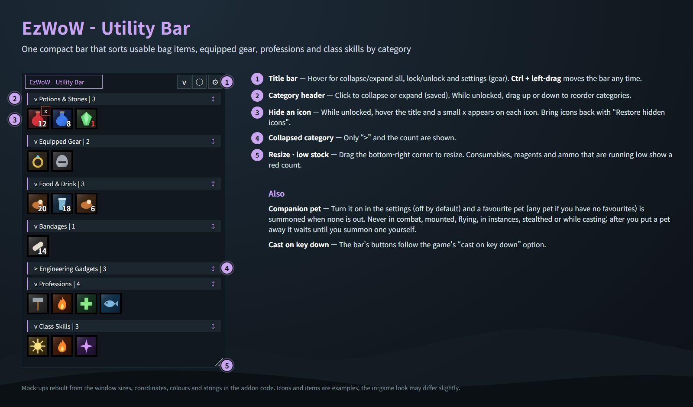
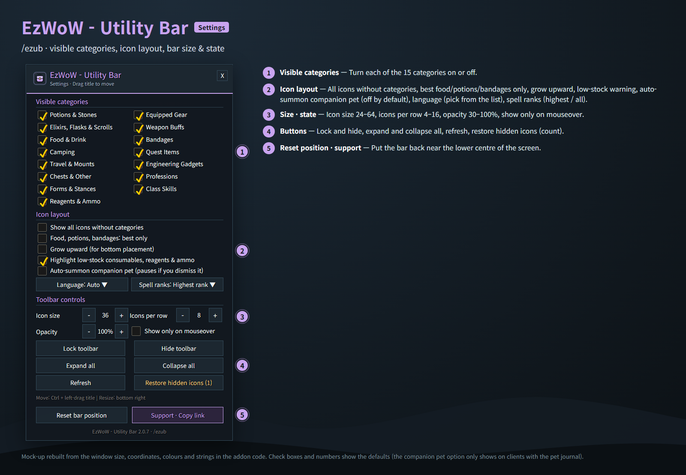
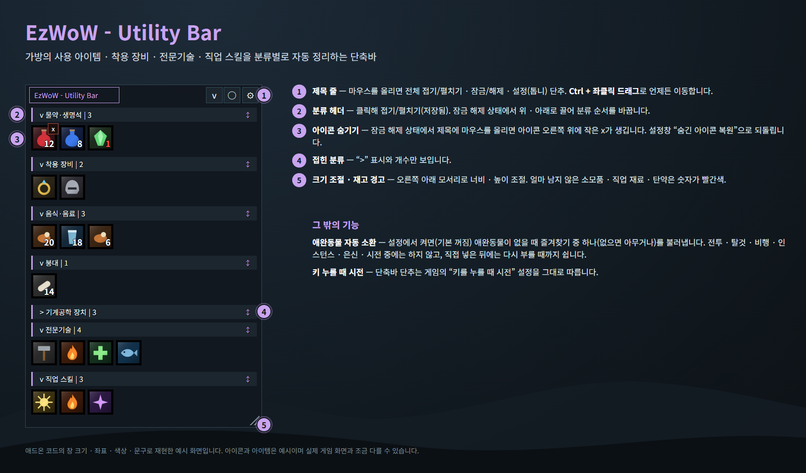
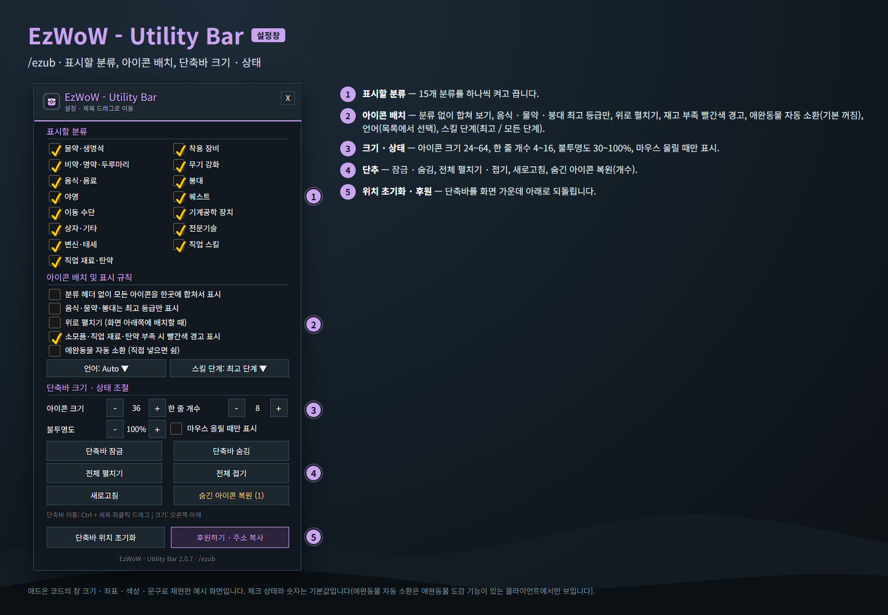

<!--
CurseForge summary (EN): One compact bar that collects your potions, food, bandages, on-use gear, professions, forms and class skills by category, with optional companion pet auto-summon.
CurseForge summary (KO): 물약·음식·붕대·사용 효과 장비·전문기술·변신·직업 스킬을 분류별로 모아 주는 작은 단축바, 애완동물 자동 소환 선택 기능.
-->

# EzWoW - Utility Bar

**English** · [한국어](#한국어)

One compact bar for WoW Forever that **collects usable bag items, equipped on-use gear, professions, forms and class utility spells, sorted by category**. Loot a new potion or learn a skill and it shows up at once; use the last one and it disappears.

*Mock-ups rebuilt from the window sizes, coordinates, colours and strings in the addon code. Icons and items are examples.*

## Features

### The bar
- 15 automatic categories: potions & stones, equipped gear, elixirs & scrolls, weapon buffs, food & drink, bandages, camping, quest items, travel & mounts, engineering gadgets, chests & other, professions, forms & stances, class skills, reagents & ammo.
- Click a category header to fold it; unlock the bar and drag headers to reorder them.
- Hide single icons with a small x (while unlocked) and restore them from the settings.
- Red counts when consumables, reagents or ammo run low.
- Optional: best food, potion and bandage for your level only; all icons without categories; grow upward.
- Secure action buttons: they work in combat, and follow the game's "cast on key down" option. In combat the layout stays put and only counts update; used-up items are dimmed and cleared after combat.
- Drag the title to move (Ctrl + drag while locked); drag the corner to resize while unlocked; icon size, icons per row, opacity, show on mouseover.
- Locking makes the background transparent and keeps the bar from moving by accident.
- Recipe items are left off the bar.

### Auto-summon companion pet (off by default)
- When no companion pet is out, the bar summons one of your favourites (any pet if you have none).
- Never in combat, mounted, flying, in instances, stealthed or while casting. If you put your pet away, it waits until you summon one yourself.

## Gamepad
- With the gamepad UI on, EzWoW windows work with a gamepad: D-pad to move, A (✕) to press, X (□) for right-click, LB/RB to scroll, B (○) to close. A key guide in your pad's button style shows under the window.
- With no game window open, press **View (Back) / Create** to move to the EzWoW frames on screen. Press it again or B to go back.
- To use another button: Key Bindings > AddOns > EzWoW > "Gamepad: move to / leave the EzWoW frames" (with EzWoW-MapFinder installed).

## Record sharing
- Shared by all EzWoW addons and **on by default**: quest NPCs, rare monster sightings, item drops and gathering spots you have seen yourself are shared with other EzWoW users.
- `/ezshare on` / `off`, `/ezshare channel on` / `off`, `/ezshare status`

## Commands
- `/ezub` (`/eub`, `/fub`, `/ezwowutilitybar`) — settings
- `/ezub lock` — lock or unlock the bar
- `/ezub show` / `/ezub hide` — show or hide the bar
- `/ezub refresh` — rescan bags, gear and spells
- `/ezub lang auto|ko|en|de|fr|es|ru|cn|tw` — change the language

Languages: English, 한국어, Deutsch, Français, Español, Русский, 简体中文, 繁體中文.

---

## 한국어

가방 속 사용 아이템, 착용 중인 사용 효과 장비, 전문기술, 변신 · 태세, 직업 보조 스킬을 **분류별로 자동 정리해서 작은 단축바 하나에 모아 주는** WoW Forever용 애드온입니다. 새 물약을 줍거나 스킬을 배우면 바로 추가되고, 다 쓰면 사라집니다.

*애드온 코드의 창 크기 · 좌표 · 색상 · 문구로 재현한 예시 화면입니다. 아이콘과 아이템은 예시입니다.*

## 기능

### 단축바
- 자동 분류 15개: 물약 · 생명석, 착용 장비, 비약 · 영약 · 두루마리, 무기 강화, 음식 · 음료, 붕대, 야영, 퀘스트, 이동 수단, 기계공학 장치, 상자 · 기타, 전문기술, 변신 · 태세, 직업 스킬, 직업 재료 · 탄약.
- 분류 헤더를 누르면 접고 펼치고, 잠금을 풀면 헤더를 끌어 순서를 바꿉니다.
- 잠금 해제 상태에서 작은 x로 아이콘을 하나씩 숨기고, 설정창에서 되돌립니다.
- 소모품 · 직업 재료 · 탄약이 얼마 남지 않으면 숫자가 빨간색.
- 선택: 내 레벨에서 쓸 수 있는 최고 등급 음식 · 물약 · 붕대만, 분류 없이 합쳐 보기, 위로 펼치기.
- 보안 액션 버튼이라 전투 중에도 동작하고, 게임의 "키를 누를 때 시전" 설정을 따릅니다. 전투 중에는 목록을 그대로 두고 수량만 갱신하며, 다 쓴 아이템은 반투명하게 두었다가 전투가 끝나면 정리합니다.
- 제목을 끌어 이동(잠긴 상태에서는 Ctrl + 드래그), 잠금 해제 상태에서 모서리로 크기 조절, 아이콘 크기 · 한 줄 개수 · 불투명도 · 마우스 올릴 때만 표시.
- 잠그면 배경이 투명해지고 실수로 움직이지 않습니다.
- 제조법 아이템은 단축바에 넣지 않습니다.

### 애완동물 자동 소환 (기본 꺼짐)
- 애완동물이 나와 있지 않으면 즐겨찾기 애완동물 중 하나(없으면 아무거나)를 불러냅니다.
- 전투 · 탈것 · 비행 · 인스턴스 · 은신 · 시전 중에는 부르지 않습니다. 직접 넣으면 다시 부를 때까지 쉽니다.

## 게임패드
- 게임패드 UI를 켜면 EzWoW 창을 패드로 다룰 수 있습니다. 방향키로 이동, A(✕)로 누르기, X(□)로 오른쪽 클릭, LB/RB로 스크롤, B(○)로 닫기입니다. 창 아래에 연결된 패드 모양으로 키 안내가 나옵니다.
- 블리자드 창이 열려 있지 않을 때 **보기(Back) / Create 버튼**을 누르면 화면의 EzWoW 프레임으로 이동합니다. 다시 누르거나 B를 누르면 돌아갑니다.
- 다른 버튼을 쓰려면: 설정 > 단축키 > 애드온 > EzWoW > "게임패드: EzWoW 창으로 이동/돌아가기" (EzWoW-MapFinder 설치 시)

## 기록 공유
- 모든 EzWoW 애드온이 함께 쓰며 **기본으로 켜져 있습니다**. 직접 확인한 퀘스트 NPC, 희귀 몬스터 목격, 아이템 드롭, 채집 위치를 다른 EzWoW 사용자와 나눕니다.
- `/ezshare on` / `off` (또는 `/공유`), `/ezshare channel on` / `off`, `/ezshare status`

## 명령어
- `/ezub` (`/eub`, `/fub`, `/ezwowutilitybar`) — 설정창
- `/ezub lock` — 단축바 잠금/해제
- `/ezub show` / `/ezub hide` — 단축바 표시 / 숨기기
- `/ezub refresh` — 가방 · 장비 · 주문 다시 읽기
- `/ezub lang auto|ko|en|de|fr|es|ru|cn|tw` — 언어 변경

지원 언어: English, 한국어, Deutsch, Français, Español, Русский, 简体中文, 繁體中文.
